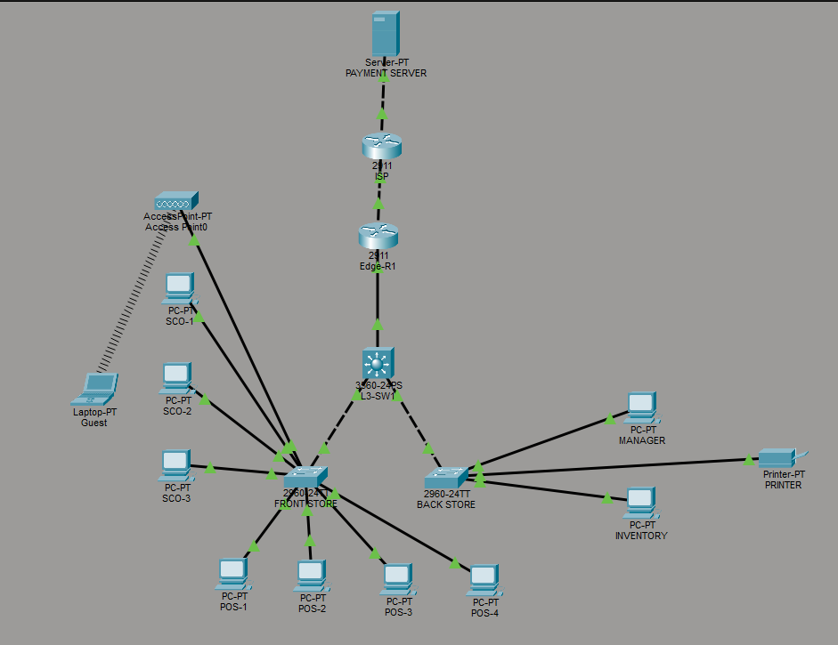
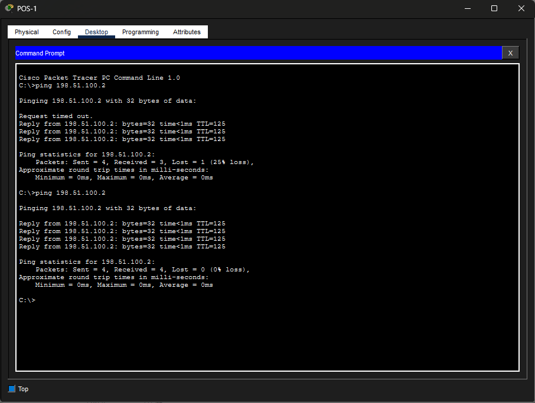
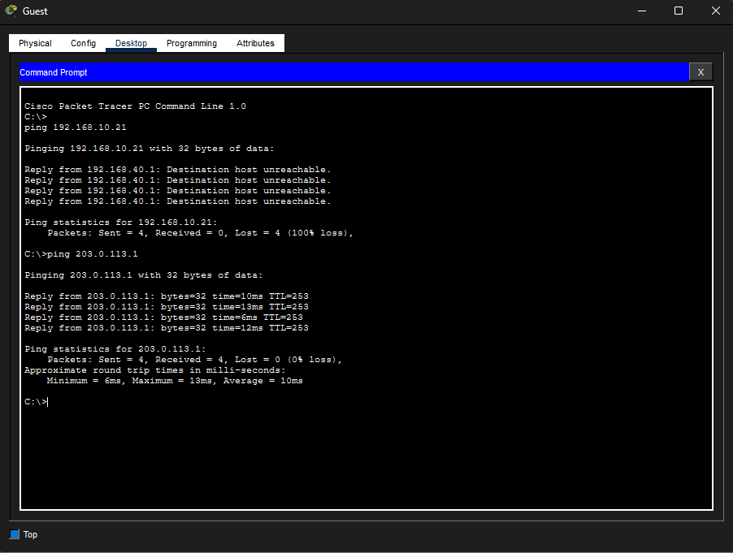
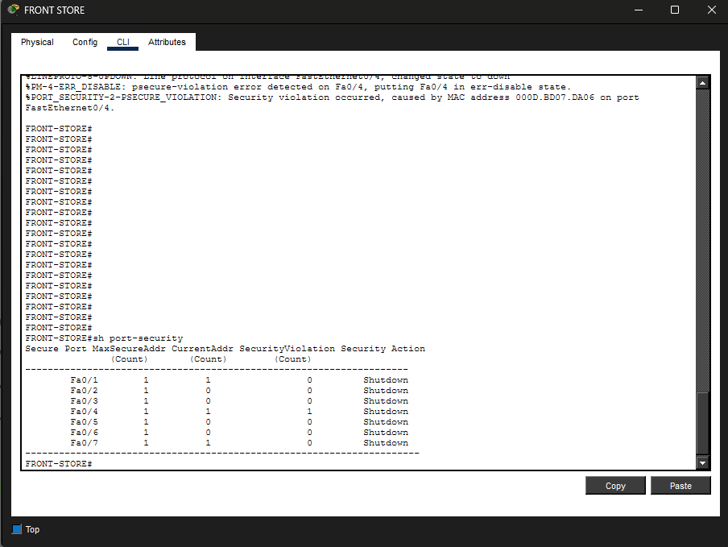

# Small Retail Store Network (Cisco Packet Tracer)

A segmented, secure network design for a small retail store, built and tested in Cisco Packet Tracer. The project covers VLAN segmentation, inter-VLAN routing on a Layer 3 switch, DHCP, NAT/PAT, access control between zones, secure remote management with SSH, and port security on checkout connections.

---

## Table of Contents

- [Project Overview](#project-overview)
- [Topology](#topology)
- [Devices](#devices)
- [VLAN & IP Addressing Plan](#vlan--ip-addressing-plan)
- [Features Implemented](#features-implemented)
- [Security Design](#security-design)
- [Key Tests](#key-tests)
- [Skills Demonstrated](#skills-demonstrated)
- [Possible Improvements](#possible-improvements)
- [Repository Structure](#repository-structure)

---

## Project Overview

The goal was to design a network for a small retail store where different types of devices are kept in separate zones, so that a problem or compromise in one area does not affect the others. In particular:

- Payment-related devices (POS and self-checkout) can reach the payment server.
- Guests on the Wi-Fi get internet access only, with no access to internal networks.
- All switches and routers are managed remotely and securely.
- Unused ports are disabled and checkout ports are protected against unauthorized devices.

## Topology



## Devices

| Device | Model | Role |
| :--- | :--- | :--- |
| PAYMENT SERVER | Server-PT | Payment processing server (external) |
| ISP | Cisco 2911 | Simulated internet service provider |
| Edge-R1 | Cisco 2911 | Edge router: default route to ISP and PAT |
| L3-SW1 | Cisco 3560-24PS | Layer 3 switch: inter-VLAN routing and DHCP |
| FRONT STORE | Cisco 2960-24TT | Access switch for checkout area (POS, SCO, Wi-Fi) |
| BACK STORE | Cisco 2960-24TT | Access switch for back office and printer |
| Access Point0 | AccessPoint-PT | Guest wireless access |
| POS-1 to POS-4 | PC-PT | Point-of-sale terminals |
| SCO-1 to SCO-3 | PC-PT | Self-checkout kiosks |
| MANAGER, INVENTORY | PC-PT | Back office workstations |
| PRINTER | Printer-PT | Network printer |
| Guest | Laptop-PT | Customer wireless device |

## VLAN & IP Addressing Plan

| VLAN | Name | Subnet | Gateway | Description |
| :--- | :--- | :--- | :--- | :--- |
| **10** | POS | `192.168.10.0/24` | `192.168.10.1` | POS Terminals |
| **20** | SELF_CHECKOUT | `192.168.20.0/24` | `192.168.20.1` | Self-Checkout Kiosks |
| **30** | BACK_OFFICE | `192.168.30.0/24` | `192.168.30.1` | Staff & Inventory Systems |
| **40** | GUEST_WIFI | `192.168.40.0/24` | `192.168.40.1` | Customer Wireless Access |
| **50** | PRINTERS | `192.168.50.0/24` | `192.168.50.1` | Network Printers |
| **99** | MANAGEMENT | `192.168.99.0/24` | `192.168.99.1` | Switch & Router Management |
| **999** | UNUSED | N/A | N/A | Disabled Ports |

## Features Implemented

### VLAN Segmentation
Five user VLANs separate POS, self-checkout, back office, guest Wi-Fi and printers. VLAN 99 is dedicated to switch and router management, and VLAN 999 is a "parking" VLAN for unused ports.

### Inter-VLAN Routing
**L3-SW1** performs inter-VLAN routing using SVIs, acting as the default gateway for every VLAN. Trunk links connect it to the FRONT STORE and BACK STORE access switches.

### DHCP
Client devices automatically receive an IP address, gateway and DNS information for their VLAN, so no manual addressing is needed on end devices.

### Edge Routing and PAT
**Edge-R1** provides the private network with a path to the ISP and performs PAT (NAT overload), allowing all internal hosts to share a single public address.

### Access Control Between Zones
- POS and SCO VLANs can reach the **payment server**.
- The **guest Wi-Fi** VLAN can reach outside resources (internet) but **cannot** reach sensitive internal networks.

### Secure Remote Management
**SSH** is enabled on the network devices for encrypted remote administration, replacing Telnet.

### Port Security
Port security is enabled on the checkout ports to block unauthorized devices from connecting to the Ethernet ports of the POS and self-checkout stations.

### Unused Port Hardening
All unused switch ports are administratively shut down and assigned to VLAN 999.

## Security Design

| Threat | Mitigation |
| :--- | :--- |
| Guest accessing internal systems | Guest VLAN isolated by access control; internet access only |
| Rogue device plugged into a checkout port | Port security on checkout ports |
| Unauthorized use of empty wall/switch ports | Unused ports shut down and moved to VLAN 999 |
| Insecure device administration | SSH only, with a dedicated management VLAN (99) |
| Payment traffic exposed to other zones | Only POS and SCO VLANs permitted to the payment server |

## Key Tests

### 1. POS can reach the Payment Server
Confirms that payment traffic works end to end: DHCP, inter-VLAN routing, PAT and the path through the ISP.



### 2. Guest Wi-Fi is isolated from internal networks
The guest laptop can reach outside resources but is blocked from the internal VLANs, proving the segmentation and access control work.



### 3. Port security blocks unauthorized devices
Connecting an unauthorized device to a protected checkout port triggers a security violation, protecting the payment environment.



## Skills Demonstrated

- VLAN design and trunking (802.1Q)
- Inter-VLAN routing with a Layer 3 switch
- DHCP configuration
- NAT/PAT
- Static and default routing
- Access control lists / network segmentation
- Port security and switch hardening
- SSH and secure device management
- IP addressing and subnetting
- Network documentation and troubleshooting
- Cisco IOS CLI

## Possible Improvements

- Add a redundant link and EtherChannel between L3-SW1 and the access switches
- Implement DHCP snooping and Dynamic ARP Inspection
- Add a second edge router with HSRP for gateway redundancy
- Replace static routing with OSPF
- Add a syslog and SNMP monitoring server
- Apply WPA2/WPA3 and a captive portal on the guest wireless network

## Repository Structure

```
.
├── README.md
├── retail-store-network.pkt
└── images/
    ├── topology.png
    ├── ping-pos-to-payment.png
    ├── guest-isolation.png
    └── port-security.png
```
